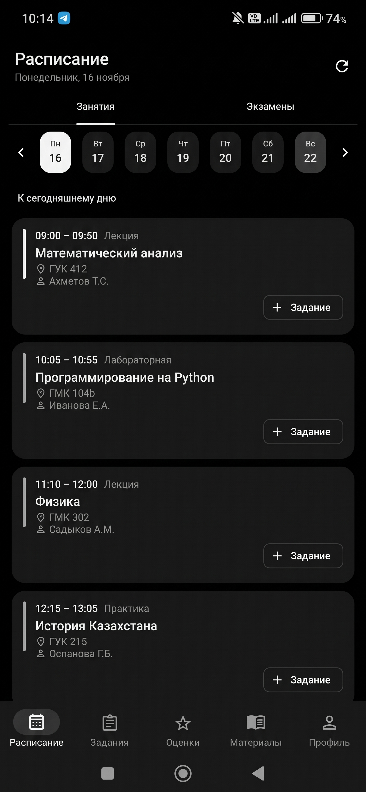
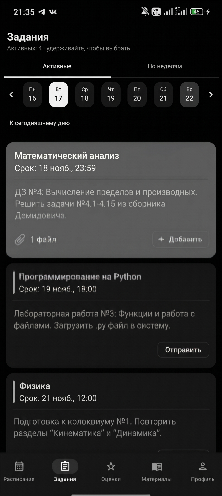
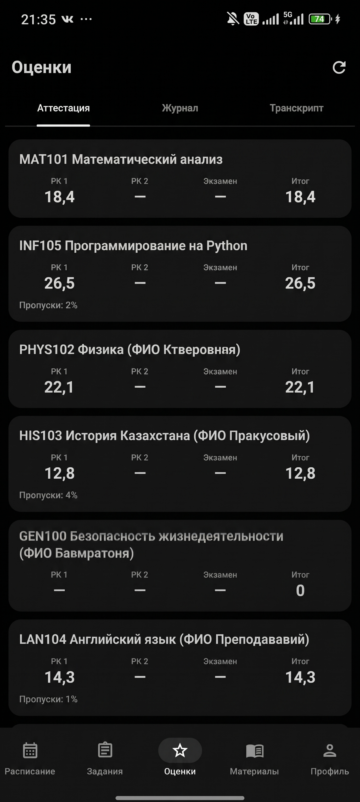
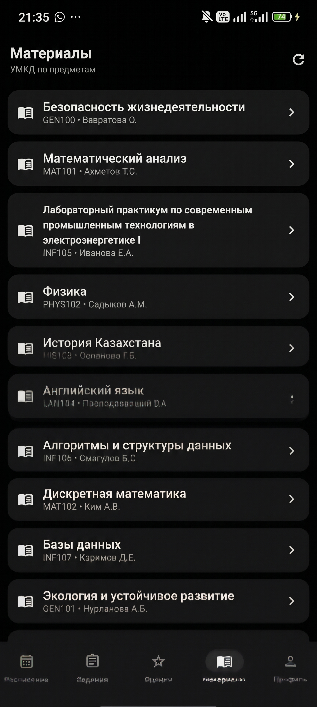
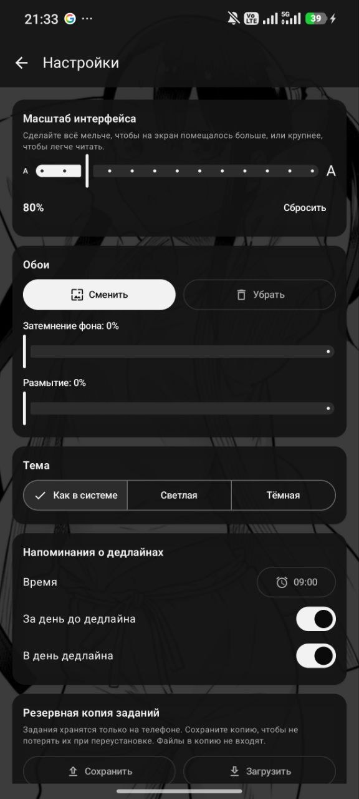

# Satbayev+

Неофициальное Android-приложение для студентов Satbayev University: расписание, задания, оценки и материалы в одном месте. Написано на Kotlin + Jetpack Compose.

> Проект не связан с университетом и не является официальным. Данные берутся из того же API, что и в официальном приложении (`ssomobile.satbayev.university`), под вашим собственным логином.

## Скриншоты

| Расписание | Задания | Оценки |
|:---:|:---:|:---:|
|  |  |  |

| Материалы | Настройки |
|:---:|:---:|
|  |  |

## Возможности

- **Расписание** — неделя, текущая пара, экзамены, кнопка «+ Задание» у каждого урока.
- **Задания** — создать (текст + урок из расписания), выполнять (текст, фото, файлы), «Закончить урок»; вкладки «Активные» и «По неделям» с календарём.
- **Оценки** — аттестация (РК 1, РК 2, экзамен, итог, пропуски), журнал, транскрипт / GPA.
- **Материалы** — УМКД по предметам.
- **Новости, уведомления и профиль** — в профиле есть кнопка «Перейти на SSO», которая открывает сайт университета в браузере.
- **Виджеты** на рабочий стол.
- **Напоминания о дедлайнах** — за день и в день дедлайна, время настраивается.
- **Настройки** — обои из галереи (затемнение, размытие), масштаб интерфейса 70–130 %, тема (светлая / тёмная / как в системе), резервная копия заданий.

Задания хранятся только на телефоне (Room), поэтому делайте резервную копию в настройках перед переустановкой. Файлы в копию не входят.

## Установка

Готовый APK лежит в разделе [Releases](../../releases). Скачайте `Satbayev+.apk`, разрешите установку из неизвестных источников и установите.

Требуется Android 8.0 (API 26) или новее.

## Стек

- Kotlin, Jetpack Compose, Material 3
- Retrofit + OkHttp — сетевые запросы
- Room — локальная база заданий
- WorkManager — напоминания о дедлайнах
- Glance — виджеты
- Coil — загрузка изображений

## Структура проекта

```
app/src/main/java/kz/satbayev/plus/
├── data/      API, репозиторий, модели, Room (db/), настройки, задания
├── ui/        тема, общие компоненты, экраны (screens/)
├── widget/    виджеты Glance
├── worker/    DeadlineWorker — напоминания
├── AppViewModel.kt
└── MainActivity.kt
```

## Сборка

Откройте папку в Android Studio и запустите сборку, либо из командной строки:

```
gradlew.bat assembleRelease
```

На Windows результаты сборки складываются в `C:\Temp\satbayevplus-build` (см. `build.gradle.kts`), готовый APK: `C:\Temp\satbayevplus-build\app\outputs\apk\release\app-release.apk`.

Release-сборка подписывается отладочным ключом, чтобы APK сразу ставился на телефон.

## Версия

1.4 (versionCode 16)
